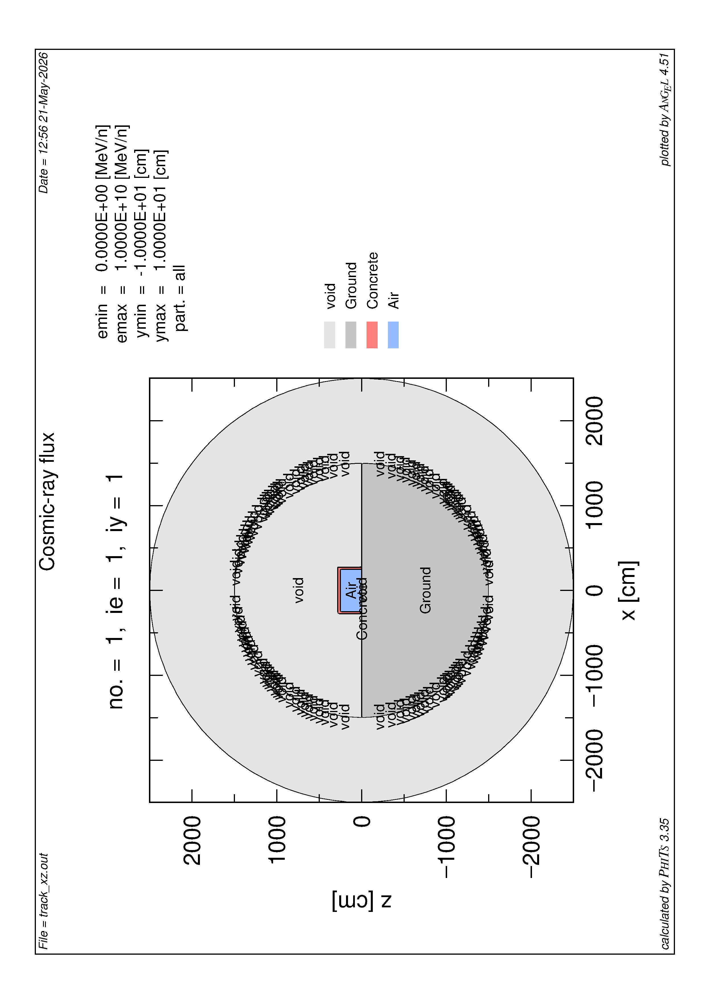
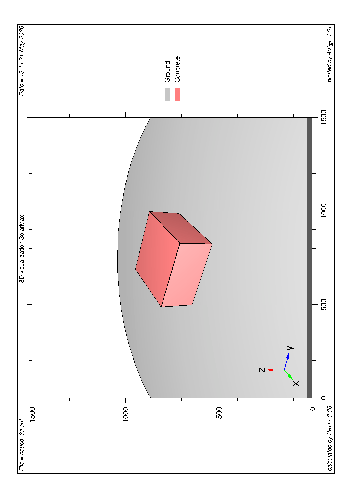

# Analyse de la Géométrie : Maison ModernYde

Ce document présente l'analyse de la géométrie de la maison "ModernYde" telle qu'elle est configurée dans la simulation PHITS pour l'étude de l'atténuation des rayons cosmiques.

## Vue en coupe 2D (Plan X-Z)

L'image ci-dessous a été générée en utilisant la fonction `gshow` de PHITS, qui permet de vérifier visuellement la répartition des matériaux et les dimensions géométriques avant le calcul du transport des particules.

> [!NOTE]
> **Axe Horizontal (X) :** Représente la largeur de la maison en centimètres.
> **Axe Vertical (Z) :** Représente la hauteur en centimètres.

## Modélisation 3D (SolarMax et SolarMin)

Voici le rendu en 3 dimensions de la géométrie de la maison, généré par le moteur de rendu 3D de PHITS (`[T-3dshow]`). 

### 🌐 Visualisation 3D Interactive (Directement intégrée ci-dessous)

<iframe src="modernyde_3d_viewer.html" width="100%" height="550" style="border: 2px solid rgba(0, 200, 255, 0.25); border-radius: 12px; background: #0a0d14;"></iframe>

> [!TIP]
> **Commandes de l'Iframe :** Cliquez dedans, puis faites glisser pour pivoter (clic gauche) | Utilisez la molette pour zoomer | Utilisez les flèches du clavier pour vous déplacer.
> 
> *Note : Si votre visionneuse bloque l'iframe, vous pouvez toujours :*
> **[Ouvrir le Visualiseur 3D Interactif en plein écran](modernyde_3d_viewer.html)**

> [!NOTE]
> Cette géométrie est rigoureusement **identique** pour les deux modèles d'irradiation cosmique : **SolarmaxYdeMod** et **SolarminYdeMod**. La seule différence entre ces deux simulations réside dans l'intensité et le spectre de la source (le rayonnement cosmique est affecté par l'activité solaire), mais l'environnement physique (la maison) ne change pas.

---

## Proportions et Matériaux

Bien que la base de données du fichier de simulation contienne de multiples matériaux (Bois, Zinc, Briques d'argile, Paille, Rafia...), la maquette actuelle se concentre sur les éléments d'une habitation moderne standardisée en béton.

### 1. Structure Principale (Rose)
* **Matériau :** Béton (Densité : 2.2 g/cm³)
* **Dimensions intérieures :** La pièce centrale est un carré de **5 mètres sur 5 mètres**.
* **Hauteur sous plafond :** **2,5 mètres** (Z varie de 0 à 250 cm).
* **Épaisseur des murs :** Les murs sont constitués d'une couche principale de 20 cm, recouverte d'un crépissage en béton de 2 cm (épaisseur totale de 22 cm). Le toit a une épaisseur de 30 cm.

### 2. Le Sol (Gris)
* **Matériau :** Terrain / Sol naturel (Densité : 1.9 g/cm³)
* **Position :** Il s'étend sous la maison (pour toutes les valeurs de Z < 0), servant de bouclier contre les rayonnements secondaires susceptibles d'être rétrodiffusés par le sol.

### 3. L'Air (Bleu pastel / Blanc)
* **Matériau :** Air (Densité : 1.21 mg/cm³)
* **Position :** Il remplit l'espace de vie à l'intérieur de la pièce (bleu pastel clair) ainsi que l'environnement extérieur entourant la maison.

> [!TIP]
> **Pourquoi cette vérification est-elle cruciale ?**
> La modélisation de l'atténuation des rayons cosmiques dépend fortement de la précision des épaisseurs et de la densité des matériaux traversés. Cette cartographie confirme que le modèle de la maison est fermé et prêt pour le calcul de dose.
