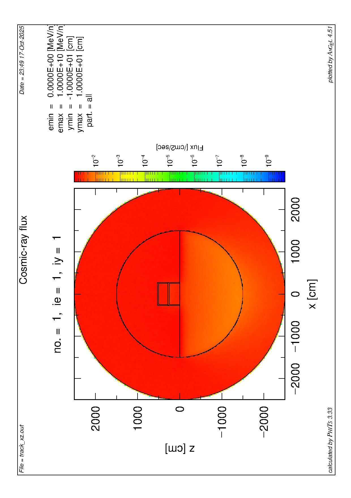
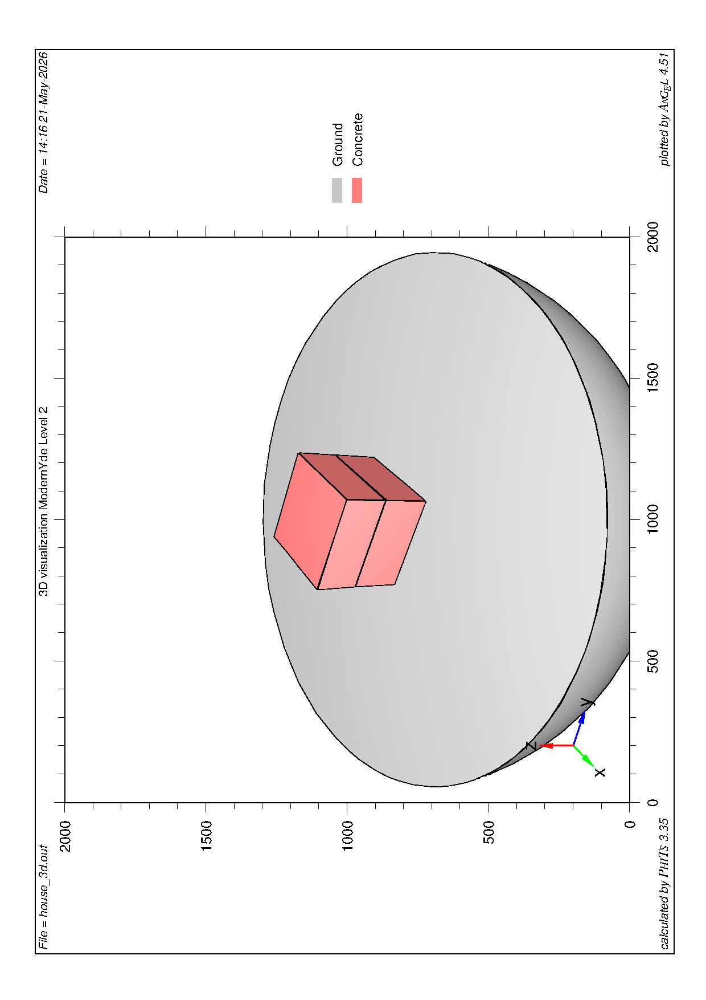

# Analyse de la Géométrie : Maison ModernYde Level 2 (2 Étages)

Ce document présente l'analyse de la géométrie de la maison en béton à deux étages "ModernYde Level 2" telle qu'elle est configurée dans la simulation PHITS pour l'étude de l'atténuation des rayons cosmiques.

---

## Vue en coupe 2D (Plan X-Z)

L'image ci-dessous a été générée en utilisant la fonction `gshow` de PHITS, montrant les deux niveaux superposés et la répartition des matériaux.

> [!NOTE]
> * **Axe Horizontal (X) :** Représente la largeur de la maison en centimètres.
> * **Axe Vertical (Z) :** Représente la hauteur totale en centimètres (on distingue nettement les deux étages s'élevant jusqu'à 530 cm).

---

## Modélisation 3D (SolarMax et SolarMin)

Voici le rendu en 3 dimensions de la géométrie de la maison à deux étages, généré par le moteur de rendu 3D de PHITS (`[T-3dshow]`).

### 🌐 Visualisation 3D Interactive (Directement intégrée ci-dessous)

<iframe src="modernydelevel2_3d_viewer.html" width="100%" height="550" style="border: 2px solid rgba(0, 200, 255, 0.25); border-radius: 12px; background: #0a0d14;"></iframe>

> [!TIP]
> **Commandes de l'Iframe :** Cliquez dedans, puis faites glisser pour pivoter (clic gauche) | Utilisez la molette pour zoomer | Utilisez les flèches du clavier pour vous déplacer.
> 
> *Note : Si votre visionneuse bloque l'iframe, vous pouvez toujours :*
> **[Ouvrir le Visualiseur 3D Interactif en plein écran](modernydelevel2_3d_viewer.html)**

---

## Structure, Proportions et Matériaux

La maison **ModernYde Level 2** est une extension verticale de la ModernYde classique. Elle possède une structure en béton armé à double niveau, créant un blindage cumulé plus important pour le rez-de-chaussée.

### 1. Rez-de-chaussée (RDC - Level 1)
* **Dimensions intérieures :** Pièce carrée de **5 mètres sur 5 mètres** ($X, Y \in [-250, 250]$ cm).
* **Hauteur sous plafond :** **2,5 mètres** ($Z \in [0, 250]$ cm).
* **Dalle de séparation (R+1) :** Épaisseur de 30 cm de béton, servant de plafond pour le RDC et de plancher pour l'étage ($Z \in [250, 280]$ cm).

### 2. Premier Étage (R+1 - Level 2)
* **Dimensions intérieures :** Pièce carrée identique de **5 mètres sur 5 mètres** ($X, Y \in [-250, 250]$ cm).
* **Hauteur sous plafond :** **2,2 mètres** ($Z \in [280, 500]$ cm).
* **Dalle de toit (Toiture terrasse) :** Épaisseur de 30 cm de béton ($Z \in [500, 530]$ cm).

### 3. Les Murs
* **Matériau :** Béton dense (Densité : 2.2 g/cm³, MAT3)
* **Épaisseur des murs :** Les murs extérieurs font 20 cm d'épaisseur avec un crépissage de 2 cm sur chaque face, soit **24 cm au total** ($X, Y \in [250, 274]$ cm).

---

## Matériaux de la Simulation (PHITS)

| Matériau | Couleur PHITS | Densité | Rôle Dosimétrique |
|---|---|---|---|
| **Béton dense** (MAT3) | Rose | 2.2 g/cm³ | Structure porteuse, dalles de sol, d'étage et de toit. Offre un blindage optimal. |
| **Air intérieur** (MAT1) | Bleu pastel | $1.21 \times 10^{-3}$ g/cm³ | Milieu dans lequel la dose équivalente est mesurée (RDC et R+1). |
| **Sol naturel** (MAT5) | Gris | 1.9 g/cm³ | Terrain sous la maison ($Z < 0$). Absorbe et rétrodiffuse le rayonnement secondaire. |

> [!IMPORTANT]
> **Conséquence Dosimétrique Clé :**
> Grâce à la superposition des deux étages, le **rez-de-chaussée (Level 1)** bénéficie d'une double couche de blindage vertical (la dalle intermédiaire de 30 cm + la dalle de toit de 30 cm + la couche d'air intermédiaire). L'atténuation du flux de muons et de neutrons cosmiques secondaires y est donc significativement supérieure à celle mesurée au premier étage (Level 2).
