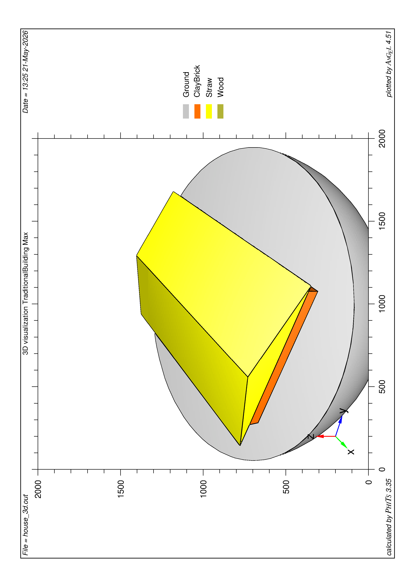

# Analyse de la Géométrie : TraditionalBuilding_2

Ce document présente la géométrie de la maison traditionnelle de Douala simulée dans PHITS pour l'étude de l'atténuation des rayons cosmiques, avec les visualisations 3D pour les deux conditions d'activité solaire.

---

## Visualisation 3D — SolarMax (activité solaire maximale)

Rendu généré via `[T-3Dshow]` avec `icntl = 11` sur le fichier [CosmicRay_3dshow.inp](file:///C:/Users/PC/Desktop/Alex-PHITS/TraditionalBuilding_2/TraditionalBuilding/Max/CosmicRay_3dshow.inp).

---

## Visualisation 3D — SolarMin (activité solaire minimale)

Rendu généré via `[T-3Dshow]` avec `icntl = 11` sur le fichier [CosmicRay_3dshow.inp](file:///C:/Users/PC/Desktop/Alex-PHITS/TraditionalBuilding_2/TraditionalBuilding/Min/CosmicRay_3dshow.inp).

### 🌐 Visualisation 3D Interactive (Directement intégrée ci-dessous)

<iframe src="traditionalbuild2_3d_viewer.html" width="100%" height="550" style="border: 2px solid rgba(255, 140, 0, 0.25); border-radius: 12px; background: #0a0d14;"></iframe>

> [!TIP]
> **Commandes de l'Iframe :** Cliquez dedans, puis faites glisser pour pivoter (clic gauche) | Utilisez la molette pour zoomer | Utilisez les flèches du clavier pour vous déplacer.
> 
> *Note : Si votre visionneuse bloque l'iframe, vous pouvez toujours :*
> **[Ouvrir le Visualiseur 3D Interactif en plein écran](traditionalbuild2_3d_viewer.html)**

> [!NOTE]
> Les deux rendus sont **géométriquement identiques**. La différence entre **Max** et **Min** porte uniquement sur le spectre de la source cosmique (modulation solaire), pas sur la structure physique de la maison.

---

## Matériaux et Proportions

Cette maison est une **habitation traditionnelle rectangulaire** avec toit en pente en paille, murs en briques d'argile, et plafond en bois. Sa géométrie est notablement plus complexe que la ModernYde.

### Dimensions principales

| Élément | Valeur |
|---|---|
| Longueur intérieure (X) | **19 mètres** (−950 cm à +950 cm) |
| Largeur intérieure (Y) | **13 mètres** (−650 cm à +650 cm) |
| Hauteur sous plafond (Z) | **2,5 mètres** (0 à 250 cm) |
| Hauteur totale avec toit | **7,5 mètres** (jusqu'à 750 cm) |

### Couches de murs

| Couche | Matériau | Couleur PHITS | Densité | Épaisseur |
|---|---|---|---|---|
| Revêtement intérieur | **Béton léger** (Concrete) | Rose | 2.2 g/cm³ | 2 cm |
| Structure principale | **Briques d'argile** (ClayBrick) | Orange | 2.188 g/cm³ | 20 cm |
| Revêtement extérieur | **Béton léger** (Concrete) | Rose | 2.2 g/cm³ | 2 cm |

### Éléments spécifiques à la maison traditionnelle

| Région | Matériau | Couleur PHITS | Densité | Rôle |
|---|---|---|---|---|
| Plafond / Grenier | **Bois** (Wood - Eucalyptus) | Camel | 0.54 g/cm³ | Séparation entre pièce et toit |
| Toit | **Paille** (Straw) | Jaune | 0.24 g/cm³ | Couverture inclinée en V |
| Sol | **Sol naturel** (Ground, SiO₂) | Gris | 1.9 g/cm³ | Dessous de la maison (Z < 0) |
| Intérieur / Extérieur | **Air** | Bleu pastel | 1.21×10⁻³ g/cm³ | Volume de vie et environnement |

### Géométrie du toit en pente
Le toit est modélisé par des **plans inclinés** (surfaces `p` dans PHITS) formant un triangle isocèle :
- Hauteur du faîtage : **2,5 m** au-dessus du plafond (500 cm depuis le sol)
- Envergure maximale : **± 12 m** débordant des murs

> [!TIP]
> **Implication dosimétrique clé :** Par rapport à la maison moderne en béton, la maison traditionnelle a des murs en briques d'argile (matériau plus léger) mais un **toit en paille très peu dense** (0.24 g/cm³). Le faîte en paille offre donc une très faible atténuation aux rayons cosmiques incidents verticalement, contrairement au béton.

> [!IMPORTANT]
> **Différence Max vs Min :** Lors de l'activité solaire maximale (SolarMax), le vent solaire comprime la magnétosphère et réduit légèrement le flux de rayons cosmiques galactiques atteignant la Terre. À SolarMin, ce flux est plus intense. La dose à l'intérieur de la maison sera donc plus élevée en période de minimum solaire.
